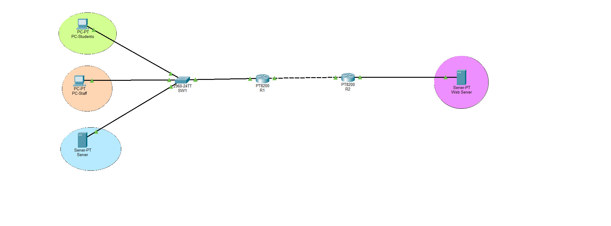

# Campus Network Design (Cisco Packet Tracer)

A multi-VLAN campus network with inter-VLAN routing, DHCP, OSPF and ACL-based access control.

## Topology

## Features
- 3 VLANs (Students, Staff, Servers) with an 802.1Q trunk
- Inter-VLAN routing using router-on-a-stick
- DHCP server on R1 for Student and Staff VLANs
- Static routing, then replaced with OSPF (single area, Area 0)
- Extended ACL that blocks Students from reaching Staff

## Addressing Plan
| Network | Subnet | Gateway |
|---|---|---|
| VLAN 10 Students | 192.168.10.0/24 | 192.168.10.1 |
| VLAN 20 Staff | 192.168.20.0/24 | 192.168.20.1 |
| VLAN 30 Servers | 192.168.30.0/24 | 192.168.30.1 |
| R1-R2 link | 10.0.0.0/30 | R1 .1, R2 .2 |
| R2 LAN | 172.16.0.0/24 | R2 .1 |

## Devices
2 routers, 1 switch, 2 PCs, 2 servers

## Configuration
Device configs are in the `configs/` folder.

## Testing
- Connectivity verified with `ping` and `tracert` (see `screenshots/`)
- OSPF neighbors verified with `show ip ospf neighbor`
- ACL verified: Students cannot ping Staff but can reach the servers

## What I Learned
- How VLANs and trunks separate traffic
- How router-on-a-stick provides inter-VLAN routing
- Differences between static routing and OSPF
- How ACLs filter traffic and why placement matters

## Tools
Cisco Packet Tracer